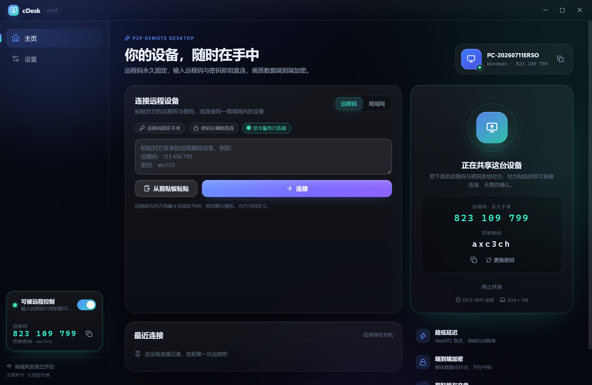
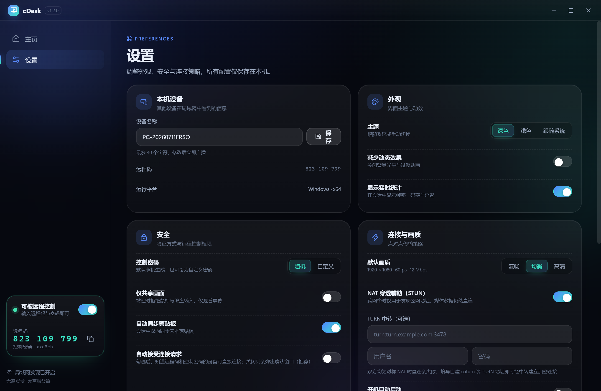

<div align="center">

# cDesk

**点对点远程桌面 · 无需服务器 · 端到端加密**

每台设备拥有永久固定的 9 位远程码与独立控制密码，粘贴即可直连；屏幕与控制数据走 WebRTC 直连，信令只传输加密后的密文。


</div>

## 界面预览

| 主页 · 远程码直连 | 设置 · 画质与网络 |
| --- | --- |
|  |  |

## 功能

- **远程码直连**：9 位固定远程码 + 控制密码，密码正确即建立连接，无需同局域网
- **远程控制**：鼠标、滚轮、键盘、中文输入注入，Windows / macOS 双平台
- **60fps 高清画面**：VP8 优先 + Simulcast 三层编码，弱网自动降层保帧率，默认 1080p60
- **连接确认**：默认弹窗确认是否接受远程协助，15 秒未响应自动拒绝；可开启「自动接受」
- **最近连接**：本地保留最近 5 台设备，点一下即可快捷重连
- **多显示器切换**、流畅 / 均衡 / 高清三档画质
- **协作能力**：双向剪贴板同步、文件传输、会话内聊天、截图、会话录制
- **实时统计**：帧率、码率、延迟、分辨率悬浮显示
- **版本检查**：自动对比 GitHub Release 版本号，发现新版本提示下载
- 深色 / 浅色主题（启动页固定浅色）、开机启动、Windows/macOS 原生窗口行为

## 技术栈

- Electron 45 + React 19 + TypeScript 5.9 + Vite 7 + electron-vite
- WebRTC：屏幕视频轨 + 两个可靠 DataChannel（`ctl` / `file`），DTLS-SRTP 加密
- 信令：UDP 广播发现 + TCP 点对点交换 SDP；跨网络使用公共 MQTT（WebSocket）交换 PBKDF2 + AES-GCM 加密的 SDP
- 远程输入注入：koffi FFI 调用 Windows `SendInput` / macOS CoreGraphics，无需 node-gyp 编译
- 状态管理 zustand，图标 lucide-react

## 环境要求

- Node.js 20+（建议 22），npm 10+
- Windows 10/11 x64，或 macOS 12+
- 打包 macOS 安装包需要 macOS 主机；也可用仓库内置的 GitHub Actions 工作流出包

## 本地开发

```bash
npm install
npm run dev
```

国内网络若 Electron 二进制下载失败，可先设置镜像：

```powershell
$env:ELECTRON_MIRROR="https://npmmirror.com/mirrors/electron/"
npm install
```

类型检查：

```bash
npm run typecheck
```

## 打包 Windows

```bash
npm ci
npm run dist:win
```

产物：

- `release/cDesk-<version>-x64-setup.exe`：NSIS 安装包（可选安装目录、桌面与开始菜单快捷方式）
- `release/win-unpacked/`：免安装版本，可直接运行 `cDesk.exe`

说明：

- 默认只构建 x64；Windows on ARM 可通过系统自带 x64 模拟运行。
- 安装包未做代码签名，首次运行 SmartScreen 提示时选择「更多信息 → 仍要运行」。
- 国内网络可先设置 `ELECTRON_MIRROR` 与 `ELECTRON_BUILDER_BINARIES_MIRROR` 加速下载。

## 打包 macOS

在 macOS 上执行：

```bash
npm ci
npm run dist:mac
```

会按 `electron-builder.yml` 中的 `mac.target` 分别产出 `cDesk-<version>-x64.dmg` 与 `cDesk-<version>-arm64.dmg`。

### 用 GitHub Actions 出包（推荐）

仓库内置 [`.github/workflows/build-mac.yml`](.github/workflows/build-mac.yml)：

- 触发方式：`workflow_dispatch` 手动运行，或在发布 Release 时自动触发
- 构建矩阵：`macos-15-intel` 出 x64 包、`macos-15`（arm64）出 arm64 包，两个架构分开构建，避免通用包在 arm64 队列长时间等待
- 产物：`cDesk-macos-dmg-x64` 与 `cDesk-macos-dmg-arm64` 两个 Artifact

### 签名与权限

- 未签名时首次打开需右键「打开」，或执行 `xattr -dr com.apple.quarantine /Applications/cDesk.app`
- 正式签名需配置 Apple Developer ID：`CSC_LINK`、`CSC_KEY_PASSWORD`
- 首次运行需在「系统设置 → 隐私与安全性」中授予「屏幕录制」和「辅助功能」权限；应用主页面会检测缺失并给出跳转按钮

## 使用

1. 被控端保持「允许远程控制」开启，主页会显示本机 **9 位远程码**（永久不变）与 **控制密码**
2. 点击复制，把「远程码 + 控制密码」发给对方
3. 主控端粘贴到连接框（支持 `123 456 789 abc123`、`远程码：… 控制密码：…` 等格式），或点「从剪贴板粘贴」
4. 被控端会弹出确认窗口（可设置为自动接受），接受后即可开始远程控制
5. 连接后可切换显示器与画质，使用聊天、文件、剪贴板、截图与录制

## 网络与安全

- 局域网发现使用 UDP 广播（端口 38999），若系统防火墙拦截需放行
- 跨网络使用公共 MQTT broker（`broker.emqx.io` / `broker.hivemq.com`，自动切换）承载信令；SDP 使用 `PBKDF2-SHA256(密码, 60000 次)` 派生的 AES-GCM-256 加密，密码本身不会上传，broker 只能看到密文
- STUN 使用国内优先的公共服务器发现公网地址（可在设置中关闭）；若双方都处于对称 NAT，请在设置中填写自建 coturn 等 TURN 服务
- 媒体与控制数据始终通过 WebRTC DTLS-SRTP 加密，点对点直连（使用 TURN 时为加密中继）
- 控制密码用于信令解密与数据通道二次鉴权，请勿公开分享

## 目录结构

```
src/
  main/            Electron 主进程（窗口、IPC、局域网信令、MQTT 信令、输入注入）
    input/         Windows / macOS 输入注入后端
  preload/         安全桥接 API
  renderer/        React 界面（主页、设置、远程会话）
  shared/          主进程与渲染层共享类型
build/             应用图标与 DMG 配置
docs/screenshots/  README 界面截图（由 scripts/capture-ui.mjs 生成）
scripts/           图标生成、界面截图等辅助脚本
.github/workflows/ macOS DMG 构建工作流
```

## 更新日志

### 1.2.1

- 修复版本检查始终失败（渲染层 CSP 阻止请求，改为主进程请求 GitHub API）
- 设置页新增新版本横幅与「前往下载」入口
- 按钮、输入框聚焦态、分段控件视觉重做
- 启动页固定浅色主题，消除启动闪黑
- README 增加真实界面截图
- macOS 工作流改为 x64 / arm64 分架构构建，规避 arm64 队列等待

### 1.2.0

- 帧率与画质：VP8 编码优先、Simulcast 三层编码、默认 60fps 高码率，弱网优先保帧率
- macOS 权限引导：主页检测「辅助功能 / 屏幕录制」权限并提供一键跳转
- 最近连接支持点击快捷重连
- 版本检查改为主进程请求 GitHub API，修复渲染层 CSP 拦截导致检查失效
- 按钮、输入框聚焦、分段控件视觉重做；启动页改为浅色
- macOS 打包工作流改为 x64 / arm64 分架构构建，规避 arm64 队列等待

### 1.1.0

- 远程码 + 控制密码直连（MQTT 加密信令）
- 鼠标注入坐标链重构，修复拖影与偏移
- 连接请求确认弹窗与「自动接受」开关

## 许可

MIT
